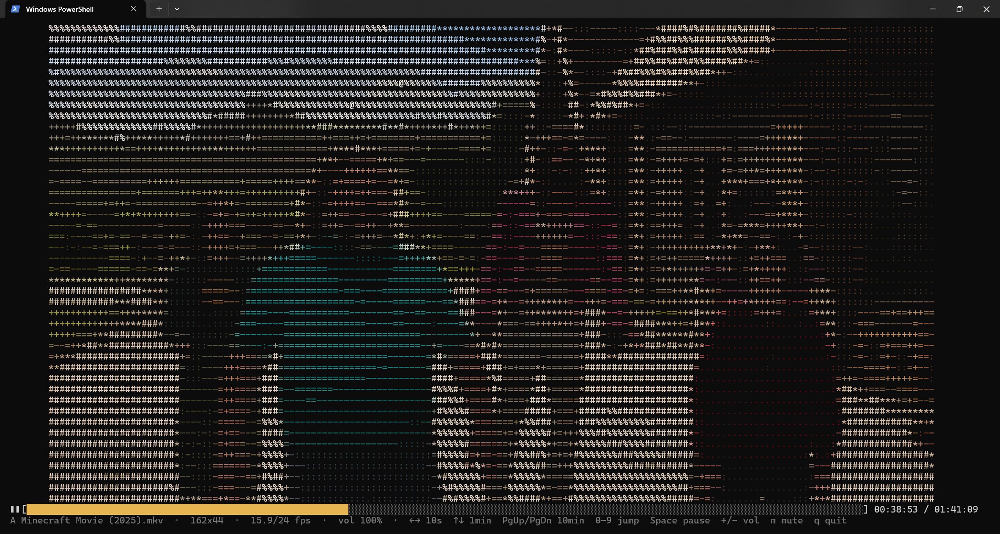

# VideoToASCII

Play any video in full color, as ASCII art, directly in your terminal, with synchronized sound, a progress bar and keyboard seeking.

> [!IMPORTANT]
> **This project was written entirely by Claude, Anthropic's AI model.** No line of code in this repository was written by hand.
> It is an experimental demo with no particular purpose: it is not maintained, offers no guarantees and is not meant for production use.



## Features

- **24-bit color** ASCII rendering, with characters chosen by brightness (` .:-=+*#%@`)
- **Synchronized audio**: the video follows the audio clock and drops frames when rendering falls behind
- **Progress bar** drawn with box-drawing characters, with elapsed and total time
- **Keyboard controls** for seeking, pausing and volume
- Adapts to the terminal size, even while playing
- Fast: each frame is encoded with vectorized NumPy operations, with no per-character Python loop

## Requirements

- Python 3.10+
- A terminal with 24-bit color support (Windows Terminal, iTerm2, most modern Linux terminals)

### Windows / macOS

```bash
pip install -r requirements.txt
```

### Linux (Debian, Ubuntu, WSL)

Recent distributions block `pip install` into the system Python ([PEP 668](https://peps.python.org/pep-0668/)), so use a virtual environment:

```bash
sudo apt install python3-venv libportaudio2
python3 -m venv .venv
source .venv/bin/activate
pip install -r requirements.txt
```

Run `source .venv/bin/activate` again in each new terminal before starting the player. `libportaudio2` is the system library `sounddevice` needs for audio output; without it, the video plays without sound.

### Dependencies

| Package | Purpose |
|---|---|
| `numpy` | Frame processing and ANSI encoding |
| `opencv-python` | Video decoding |
| `av` | Audio decoding (optional) |
| `sounddevice` | Audio output (optional) |

Without `av` and `sounddevice`, the video plays without sound.

## Usage

```bash
python video_ascii.py path/to/video.mp4
```

### Options

| Option | Description |
|---|---|
| `--chars "+"` | Characters from darkest to brightest (default: ` .:-=+*#%@`). A single character such as `"+"` gives a uniform look |
| `--width N` | Maximum width in columns (cannot exceed the terminal width) |
| `--loop` | Loop playback |
| `--quant N` | Color quantization step; higher values mean less output and a smoother frame rate (default: `4`, `1` = none) |
| `--boost X` | Color brightness multiplier |
| `--volume N` | Initial volume in % (0-200, default `100`) |
| `--mute` | Start muted |
| `--no-audio` | Do not play sound |

### Controls

| Key | Action |
|---|---|
| `←` / `→` | Back / forward 10 seconds |
| `↑` / `↓` | Forward / back 1 minute |
| `PgUp` / `PgDn` | Forward / back 10 minutes |
| `Home` / `End` | Start / end of the video |
| `0`-`9` | Jump to 0%, 10%, ... 90% |
| `Space` | Pause / resume |
| `+` / `-` | Volume up / down |
| `m` | Mute / unmute |
| `q` / `Esc` | Quit |

## Tips

- **Higher resolution:** each character is one terminal cell, so the picture is limited by the number of columns and lines. Make the font smaller (`Ctrl` + `-` in Windows Terminal) or go full screen (`F11`) to get more detail. Use `Ctrl` + `0` to reset to the default scaling.
- **Choppy playback:** a larger picture means more text for the terminal to draw. Try `--quant 8` or a smaller `--width`.
